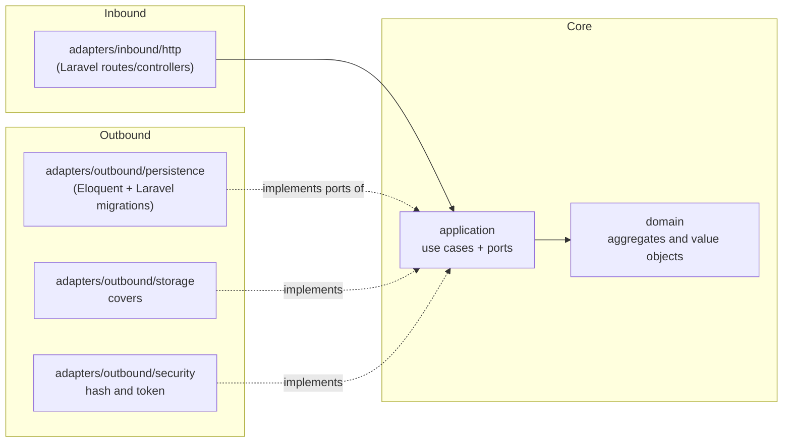
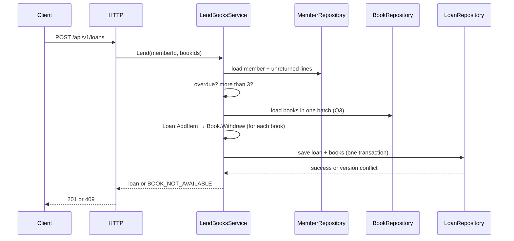

# Architecture — Manager Library (Laravel)

The system uses **hexagonal architecture** (ports and adapters). Dependency rules are defined by Articles I–III of [`constitution.md`](constitution.md).

## 1. Layers and dependencies



Dependencies point inward. `app/Providers/LibraryServiceProvider.php` is the only composition point that sees both sides.

## 2. Folder structure

```text
app/
├── Domain/                  # Book, Loan, LoanItem, Member, User; Isbn, Quantity, DateRange
├── Application/
│   ├── Ports/Outbound/      # BookRepository, LoanRepository, MemberRepository, UserRepository,
│   │                        # ReportReader, Clock, PasswordHasher, TokenIssuer, CoverStorage
│   └── Services/            # LendBooksService, ReturnItemService, CreateBookService, SearchBooksService,
│                            # OverdueService, MostBorrowedReportService, LoginService, CreateLibrarianService
├── Adapters/
│   ├── Inbound/Http/        # routes/controllers, request schemas, error handling
│   └── Outbound/            # Persistence/, Storage/, Security/
└── Providers/               # LibraryServiceProvider.php — single composition point

database/
└── migrations/              # all schema DDL and the five category seed rows
```

## 3. Aggregates

| Root | Contains | Invariants it protects |
|---|---|---|
| `Book` | `Isbn`, total and available copies, logical deletion | available copies between 0 and total; total ≥ 1; non-empty title |
| `Loan` | collection of `LoanItem` | 1 to 3 lines; no repeated book; 14-day due date; immutable except return |
| `Member` | document | required and unique document |
| `User` | role, hash | normalized username; role in (`admin`, `librarian`) |

`Loan.AddItem` calls `Book.Withdraw` before adding the line: withdrawing a copy and creating the line are one operation.
`Loan.ReturnItem` calls `Book.Restock` once per line.

## 4. Flow: register a loan



## 5. Errors

The domain and application throw their own errors (`BookNotAvailable`, `MemberHasOverdue`, `MemberLimitExceeded`, …). **Only** the HTTP adapter
translates them into the single body and status code defined in [`api-contract.md`](api-contract.md). A framework error never reaches the client.

## 6. What is not included

No events, queues, cache, microservices or multi-tenancy. Add them only if a requirement demands them.
