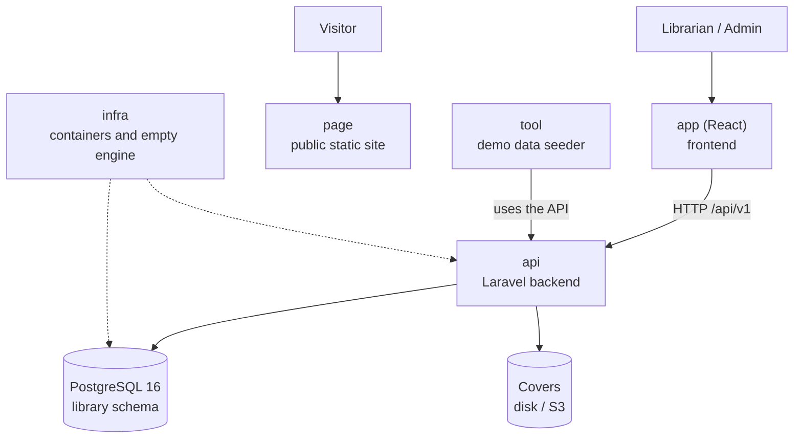

# One-page architecture — Manager Library

Read this in five minutes before opening the rest. Details are in [`architecture.md`](architecture.md).

## The system in one diagram

## The six repositories and their role

| Repo | Role | Tested with |
|---|---|---|
| `docs` | Specification | That this documentation is enough to build the system |
| `api` | Business rules and HTTP contract | Domain, application, contract and concurrency tests |
| `app` | Operational screens | End-to-end flow: login → lend → return → report |
| `page` | Public presentation without API calls | Mobile and desktop review |
| `infra` | `docker compose up` and empty database engine | One-command startup |
| `tool` | Demonstration data (books, members, loans) | Real data for the presentation |

## The five ideas that support the design

1. **A loan is an immutable fact**; only `returned_at` on a line changes.
2. **Copies are withdrawn and returned in the same operation** that creates or closes the line.
3. **Status is calculated**: `open`, `overdue` and `closed` are not stored in the database.
4. **Frozen values do not follow the catalog**: an October report does not change because a book is renamed in November.
5. **The database is the last barrier**: if the copies `CHECK` fails, something wrote outside the system boundary.
